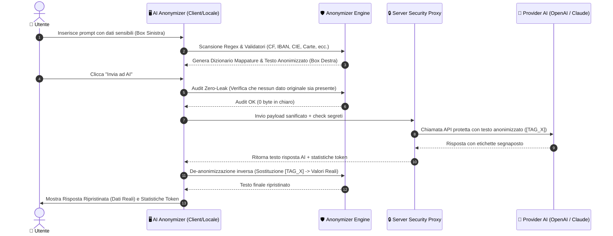

# AI Anonymizer 🛡️🇮🇹

[](https://nextjs.org/)
[](https://react.dev/)
[](https://www.typescriptlang.org/)
[](https://tailwindcss.com/)
[](https://opensource.org/licenses/MIT)

**AI Anonymizer** è un applicativo web moderno sviluppato per **anonimizzare e de-anonimizzare bidirezionalmente i prompt inviati e ricevuti da e verso modelli di Intelligenza Artificiale** (OpenAI ChatGPT, Anthropic Claude, ecc.).

L'architettura garantisce la **totale conformità agli standard italiani ed europei (GDPR)** con una politica **Zero-Leak rigorosa**: nessun dato sensibile, personale o bancario in chiaro viene mai trasmesso all'esterno o inoltrato alle AI.

---

## 📐 Architettura Bidirezionale & Flusso Zero-Leak



---

## 🚀 Tipologie di Dati Anonimizzate (Standard IT & Internazionali)

L'applicativo implementa regole di estrazione e validatori matematici/formali per ciascuna delle seguenti entità:

| Tipologia Dati | Standard / Algoritmo di Riferimento | Esempio Placeholder Generato |
| :--- | :--- | :--- |
| **Codice Fiscale** | Standard Agenzia delle Entrate DM 23/12/1976 con omocodie e check carattere controllo | `[CODICE_FISCALE_1]` |
| **Documenti d'Identità IT** | **CIE 3.0** (`CA12345AA`), Cartacea (`AA 1234567`), **Patente di guida** e **Passaporto** | `[DOCUMENT_ID_1]` |
| **IBAN & Codici Bancari** | IBAN italiano (27 caratteri `IT...`), IBAN internazionali con algoritmo **MOD-97**, codici **ABI**, **CAB** e codici **SWIFT/BIC** | `[IBAN_1]`, `[BANK_CODE_1]` |
| **Carte di Credito** | Visa, MasterCard, American Express, Diners, con validazione **Algoritmo di Luhn** (evita falsi positivi su sequenze casuali) | `[CREDIT_CARD_1]` |
| **Numeri Telefonici** | Prefissi italiani `+39` / `0039`, cellulari (`3xx`), numeri fissi con prefisso distrettuale (`0xx`) e formati internazionali | `[PHONE_1]` |
| **API Keys & Tokens** | OpenAI (`sk-...`), Anthropic (`sk-ant-...`), AWS Access Key (`AKIA...`), GitHub (`ghp_...`), JWT Bearer, Stripe (`sk_live_...`) | `[API_KEY_1]` |
| **Email Addresses** | Standard RFC 5322 | `[EMAIL_1]` |
| **Indirizzi IP** | Indirizzi IPv4 (con verifica validità ottetti 0-255) e IPv6 | `[IP_ADDRESS_1]` |
| **MAC Addresses** | Formati standard esadecimali a 6 coppie (`XX:XX:XX:XX:XX:XX` o `XXXX.XXXX.XXXX`) | `[MAC_ADDRESS_1]` |
| **UUID / GUID** | Identificatori univoci standard 8-4-4-4-12 | `[UUID_1]` |
| **Web URLs** | Link `http`, `https`, `ftp`, domini con percorsi e query string | `[URL_1]` |
| **Partita IVA** | Partita IVA italiana (11 cifre) con verifica checksum | `[PARTITA_IVA_1]` |
| **Stringhe Personalizzate** | Nomi propri, progetti riservati, aziende o Regex definite dall'utente | `[CUSTOM_1]` |

---

## 🖥️ Interfaccia Utente

1. **Box Statistiche & Token Rimanenti (Sempre Visibile)**:
   - Monitora in tempo reale il provider e modello selezionato.
   - Mostra i **token rimanenti nella finestra di contesto** per quella specifica AI (es. 128.000 token per GPT-4o, 200.000 per Claude 3.5 Sonnet) con barra di progresso percentuale.
   - Registra token in ingresso, token in uscita, totale sessione e stima dei costi.
   - Badge di sicurezza attiva che certifica 0 byte in chiaro trasmessi.

2. **Due Text Box Affiancate**:
   - **Box Sinistra**: Prompt originale in chiaro (rimane confinato sul dispositivo locale).
   - **Box Destra**: Prompt sanificato e anonimizzato in tempo reale, pronto per l'invio all'AI.

3. **Riconversione Inversa & Visualizzatore Risposta AI**:
   - Quando l'AI risponde citando le etichette, il sistema le ripristina all'istante con i valori originali.
   - Schede a confronto: **"Ripristinata (Dati Reali)"** vs **"Grezza (Anonimizzata dall'AI)"**.
   - Pulsante di de-anonimizzazione manuale inversa per qualunque testo incollato.

4. **Registro Mappature & Inspector**:
   - Tabella interattiva per visualizzare, copiare, mascherare o abilitare/disabilitare ciascuna sostituzione.
   - Esportazione del dizionario di mappatura in formato JSON.

5. **Stringhe Personalizzate**:
   - Modal per aggiungere parole chiave, frasi o espressioni regolari con etichetta personalizzata e opzione case-sensitive.

---

## 🤖 Integrazione AI Supportate

- **OpenAI**: `gpt-4o`, `gpt-4o-mini`, `gpt-4-turbo`, `gpt-3.5-turbo`.
- **Anthropic Claude**: `claude-3-5-sonnet-20241022`, `claude-3-5-haiku-20241022`, `claude-3-opus-20240229`.
- **Simulatore AI Locale (Test Senza API Key)**: Permette di provare immediatamente il funzionamento del software, la sostituzione dei token e la restituzione dei dati reali senza consumare crediti o configurare chiavi.

---

## 📦 Installazione e Avvio

### Prerequisiti
- [Node.js](https://nodejs.org/) v18 o superiore (testato anche su Node 25)
- npm o yarn o pnpm

### 1. Clonare il repository e installare le dipendenze
```bash
git clone https://github.com/speedlnx/AI-Anonymizer.git
cd AI-Anonymizer
npm install
```

### 2. Avvio in modalità sviluppo
```bash
npm run dev
```
Apri il browser su [http://localhost:3000](http://localhost:3000).

### 3. Esecuzione dei Test di Validazione
Tutti i componenti di anonimizzazione, gli algoritmi matematici e il ripristino bidirezionale dispongono di test automatizzati:
```bash
npm test
```

### 4. Compilazione e Avvio in Produzione
```bash
npm run build
npm start
```

---

## 🔒 Sicurezza & Privacy (Zero-Leak)

- **Elaborazione Locale**: Il motore di rilevamento Regex e i validatori di checksum girano direttamente all'interno del browser.
- **Pre-flight Audit**: Prima che qualunque richiesta HTTP verso le API esterne venga instradata, il motore `AnonymizerEngine.auditForDataLeak` verifica l'assenza totale di stringhe sensibili memorizzate. Se viene rilevata anche una sola corrispondenza non anonimizzata, l'invio viene abortito con allarme rosso di sicurezza.
- **API Keys Protette**: Le chiavi API dell'utente risiedono unicamente nel `localStorage` del browser e non vengono salvate su database esterni.

---

## 📄 Licenza

Rilasciato sotto licenza [MIT](LICENSE).
